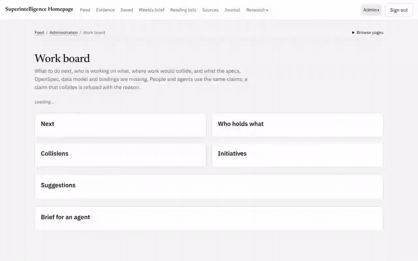
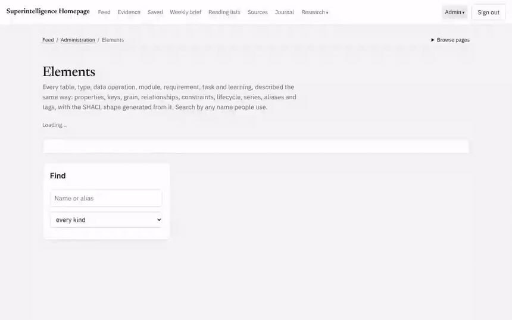
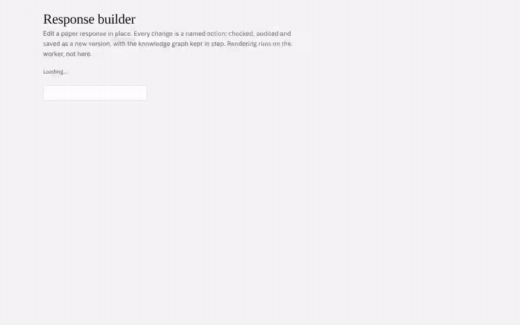

# Superintelligence Homepage

SEIS 606 Vibe Coding · Project 2 · John Affolter and Matthew Baxter

A home page for articles about superintelligence: progress toward AGI and superintelligence, and the research and policy work on making it safe. Drawn from papers, frontier lab blogs, alignment and safety groups, forecasting groups, forums and newsletters; only superintelligence stories make the feed. There's no Twitter/X: as a source, as a suggestion, or as a submitted link.

The plan both builds follow:

- [Working Agreement](WORKING_AGREEMENT.md): how we'll work together
- [Contract](CONTRACT.md): what we're building against
- [Agent Log](AGENT_LOG.md): what the agent got wrong and how we caught it (human-written)
- [Initial spec](specs/001-superintelligence-homepage/spec.md): written with Spec Kit, under the [constitution](.specify/memory/constitution.md) (prompts used: [docs/speckit-prompts.md](docs/speckit-prompts.md))
- [Spec trace](docs/SPEC_TRACE.md): how this build meets each requirement

**Start here:** [docs/OUR_PARTS.md](docs/OUR_PARTS.md) lists who does what next.

## What it does

| Feature | Detail |
| --- | --- |
| **Superintelligence feed** | 11 default sources across 5 kinds (`lib/sources.json`): arXiv (cs.AI and an alignment/safety search), Hugging Face Daily Papers, OpenAI, Google DeepMind, Alignment Forum, LessWrong, Epoch AI, AI Impacts, MIRI, Import AI. Only stories about superintelligence are shown (REQ-003); each says why. Newest first. Harvested four times a day. |
| **Story grouping** | The same paper or announcement from several sources becomes one story. An arXiv id beats a URL, and a URL beats a normalized title (`lib/feeds.js`). |
| **Ontology tags that explain themselves** | The spec's nine superintelligence topics at the top, finer topics under them, plus organizations, benchmarks and a people watchlist (`lib/ontology.json`). Every tag stores the words that matched. |
| **Accounts and curation** | Votes, saves, private or shared notes, public or private reading lists that others can follow, and submitted links. |
| **Weekly brief** | Top stories and per-topic activity, compared with last week. Built as a json-render spec on the server. |
| **Sources page** | Every feed, its kind, and whether its last fetch worked. Users suggest feeds; the admin (the first account) approves them. |
| **Agent log** | Each partner writes their own entries: what the agent got wrong, how they caught it, what they did. The editor keeps a writing record (active minutes, autosaves, typed vs pasted characters) shown on every entry and in the Markdown export. That record is evidence of how an entry was written, not proof. |

## Extended version: coordination, elements and proofs

Proposed (specs 009 and 010, not yet approved; extended version only). People and agents plan from the same task
lists, claim work before starting and are refused when they'd collide; every table, type and operation is described
the same way (keys, grain, relationships, lifecycle, series, aliases, tags, a SHACL shape); and the coordination
rules are proved in Lean and checked against the running code. Walkthrough with videos: [docs/DEMO.md](docs/DEMO.md).

| Work board | Element catalog |
| --- | --- |
|  |  |
| Ranked tasks, claims as leases, a refused collision ([MP4](docs/demo/work-board.mp4)) | Search by alias, read the description, check the data ([MP4](docs/demo/elements.mp4)) |



Two people on one paper response: presence, a stale save refused naming who saved in between, then saved on top ([MP4](docs/demo/builder-two-editors.mp4)).

## json-render

The weekly brief is a [json-render](https://github.com/vercel-labs/json-render) specs (v0.22.0). The server builds each spec from the data and validates it against the catalog (`views/catalog.mjs`) before sending it. `GET /api/catalog` exposes the catalog's AI prompt and JSON Schema, so a model could generate new views from only the approved parts later.

## Plan documents

One set, at the root, shared by both builds: the [constitution](.specify/memory/constitution.md), the [shared spec](specs/001-superintelligence-homepage/spec.md) (written with Spec Kit; prompts in [docs/speckit-prompts.md](docs/speckit-prompts.md)), the [contract](CONTRACT.md) (bake-off rules, comparison criteria, change log) and the [working agreement](WORKING_AGREEMENT.md). This build's own tables and API are in [docs/INTERFACES.md](docs/INTERFACES.md), and [docs/SPEC_TRACE.md](docs/SPEC_TRACE.md) maps every requirement to code and tests. [CONTRIBUTING.md](CONTRIBUTING.md) has the spec-to-merge flow.

## Run locally

```bash
npm install
npm run build          # bundle the json-render renderer
npm start              # http://localhost:3000; SQLite in ./data, or Postgres if DATABASE_URL is set
npm run dev:sample     # http://localhost:3200, a throwaway SQLite database with SYNTHETIC sample feeds
npm test               # two-user browser test against dev:sample (needs Playwright)
```

The same queries run on SQLite (local, tests) and Postgres (production) through `lib/db.js`. To run the test against Postgres, start `DATABASE_URL=… npm run dev:sample:pg`, then run `BASE=http://localhost:3300 npm test`.

## Working on it

- [CONTRIBUTING.md](CONTRIBUTING.md): branches, the pull request checklist, review and merge rules.
- [docs/DEPLOY.md](docs/DEPLOY.md): Vercel + Neon setup, cron, troubleshooting and the fork fallback.
- [docs/V0.md](docs/V0.md): John's v0 workflow for his bake-off version.
- [docs/HANDOFF.md](docs/HANDOFF.md): the state of John's build, how to run and check it, what waits on people (start here when picking it up).
- [docs/RESEARCH_SITE.md](docs/RESEARCH_SITE.md): the research layer as its own site that feeds the main feed (proposed, spec 002).
- [docs/PRACTICES.md](docs/PRACTICES.md): the practices this build follows and the ones still to do, with sources.
- [docs/PARITY.md](docs/PARITY.md): feature parity with comparable apps (Ground News, Particle, alphaXiv, Hugging Face Papers, scite, Epoch AI, Metaculus, NewsGuard) and the gaps worth closing.
- Admins run the research layer from the **research control room** (`/m/control`): forecasts to resolve, reviews to label, quality checks, approvals.
- `npm run preflight`: about 3 seconds of checks (syntax, build, secrets, no-Twitter, contract reminder, API smoke test). It runs on `git push` and in GitHub Actions.
- [CLAUDE.md](CLAUDE.md) / [AGENTS.md](AGENTS.md): rules for AI agents working in this repo.
- [modules/](modules/README.md): the modular monolith. Features are plug-in modules (capabilities, admin, project, generative UI with json-render, decision judges incl. JEV and CLEF) loaded by `kernel/` through extension points; switch them on or off in `modules/modules.json`.
- [agent-kit/](agent-kit/README.md): the agent kit (10 skills, 3 subagents, a guard hook and an MCP server), installable as a Claude Code plugin and exportable to Claude apps, MCP clients, Cursor, Codex and v0 (`npm run kit:export`). Claude Code in this repo loads it automatically through `.claude/`.

## Tests

`test/e2e.js` drives two signed-in users through the whole app. It runs about 100 checks, including:

- grouping and tagging
- votes, saves and notes kept separate per user
- refusing other users' edits on the server
- refusing Twitter/X
- drafts that only their author can see
- typed vs pasted counting
- Markdown export
- the json-render brief and its actions
- no sideways scrolling at phone width

Test data is synthetic: every sample record is labelled "Sample" and "test data". Live feeds weren't reachable from the build sandbox, so real-feed fetching still needs checking after the first deploy.
