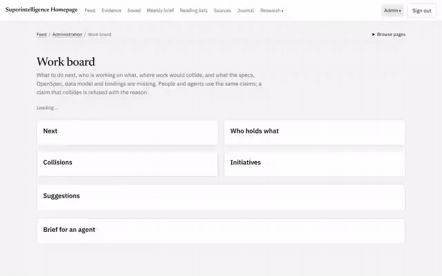
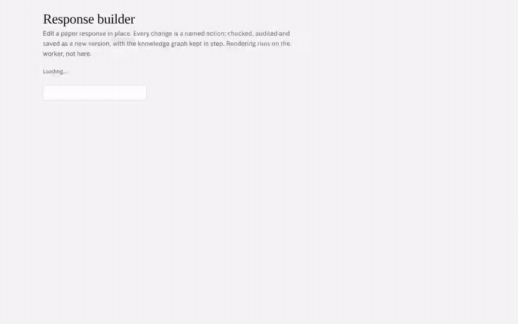
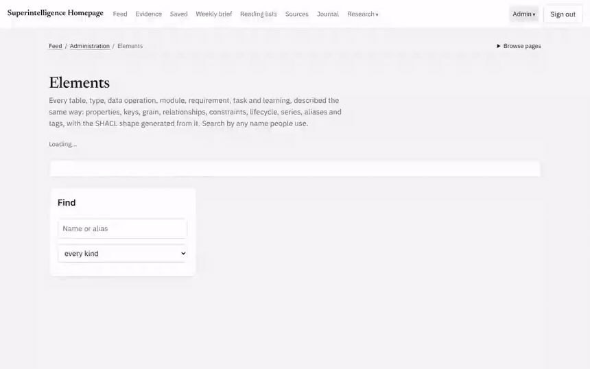

# Demo: coordination, the element catalog and the proofs

What the extended version adds for people and agents working on the same repo (proposed specs 009 and 010, not
yet approved), shown on a throwaway server with **synthetic sample data**: every account, paper and record is
labelled Sample / test data. Regenerate everything here with `npm run demo:capture` (Playwright and ffmpeg).

## 1. The work board (`/m/work`)

Open tasks from every Spec Kit and OpenSpec task list, ranked for you or for an agent you ask, each score shown as
the points behind it. Claims are leases on a task and its files; a claim that collides is refused with who holds
what and until when.



[Video (MP4, 36 s)](demo/work-board.mp4) · Still: [desktop](demo/work-board.png), [phone](demo/work-board-phone.png)

The same from a terminal (what an agent sees through `npm run work` or the `work_*` MCP tools):

```text
$ SI_ACTOR=agent:sample-a npm run work -- claim spec:006/T673 --files modules/lab/production.js
Claimed spec:006/T673 as agent:sample-a until 2026-11-12T04:34:24Z.

$ SI_ACTOR=agent:sample-b npm run work -- check spec:009/T921 --files modules/lab/
Would be refused: spec:009/T921
  ✗ agent:sample-a holds modules/lab/production.js (for spec:006/T673) until 2026-11-12T04:34:24Z.

$ SI_ACTOR=agent:sample-b npm run work -- next --limit 3
1. change:add-graph-model-and-flywheel/2.2 [agent] REQ-065 REQ-066 REQ-067 score 77
   Phase 1 recall at 100% and no SHACL violations on main for one week
   +60 unblocks 6 tasks (counted up to 5); +8 serves a SHOULD; +4 1 open suggestion on its requirements; +5 tagged for agents
2. spec:009/T921 [agent] REQ-070 score 21
   ...
```

The guard hook stops an agent editing a file someone else holds, or a shared document:

```text
Blocked by si-homepage-kit: modules/lab/production.js is claimed by agent:a for spec:006/T673 until … Pick other work (work_next), or ask them to release it.
Blocked by si-homepage-kit: CONTRACT.md is a shared document; changing it needs both partners' approval (CLAUDE.md).
```

## 2. Two people on one paper response (`/m/builder`)

The builder says who else has the response open. A save made against an old version is refused, naming who saved
in between; the page reloads, and the second edit goes in on top of the first. Nothing is overwritten.



[Video (MP4, 24 s)](demo/builder-two-editors.mp4) · Still: [builder](demo/builder.png)

Measured: 30 simultaneous saves of one version, exactly 1 lands and 29 are refused, on SQLite and on Postgres
(before the fix, 2 of 20 landed on Postgres); 30 agents claiming one file at the same instant, exactly 1 gets it.

## 3. The element catalog (`/m/elements`)

Every table, type, data operation, module, requirement, task and learning described the same way: properties,
keys and surrogates, grain, relationships with direction and cardinality, constraints, lifecycle, series, aliases
and tags, with the SHACL shape generated from it. Search by the words people use ("bookmark" finds `table:saves`),
and check an element's rows against its keys and shape.



[Video (MP4, 24 s)](demo/elements.mp4) · Still: [desktop](demo/elements.png), [phone](demo/elements-phone.png), and the [data and graph page](demo/data-and-graph.png)

```text
$ npm run elements -- report
elements: 361 (39 table, 12 type, 38 operation, 20 module, 78 requirement, 153 task, 21 learning); mean completeness 0.995; 346 complete
  DAG of acyclic relations: holds; 0 dangling; invalid 0; overlay ids matching nothing 0; alias conflicts 6
```

Another repo plugs in the same way. A Sample vibe-coding checkout (test data) with one tidy and one messy project:

```text
$ npm run elements -- check-vibe test/fixtures/vibe
collection:vibe-project: 2 rows, 2 key/grain/vocabulary problems, SHACL 1 violations
  - collection:vibe-project.status = "finished" in row 1 is not one of prototype, keeper, abandoned, TBD (sample_messy_tool)
  - collection:vibe-project.tags has "made-up-tag" in row 1, which isn't in the vocabulary (sample_messy_tool)
collection:vibe-prompt: 5 rows, 7 key/grain/vocabulary problems, SHACL 5 violations
  - collection:vibe-prompt.tool is empty in row 2 (sample_messy_tool prompt 1)
  - collection:vibe-prompt: primary key (project, number) repeats rows 3 and 4 (sample_messy_tool prompt 2)
  - collection:vibe-prompt.verified = "probably fine" in row 3 is not one of not-run, syntax-checked, agent-tested, human-tested (sample_messy_tool prompt 2)
  ...
```

The vibe-coding repo now carries the same check (`node tools/check-prompts.js`, draft PR johnaffolter/vibe-coding#1).

## 4. Does coordination pay? A simulation

Two Sample people and six Sample agents work through the repo's real open tasks, with and without claims
(`modules/work/sim.js`, 10 seeds each; `npm run test:work`):

| | Without claims | With claims |
| --- | --- | --- |
| Duplicate work (12 ticks) | 62 | 0 |
| File collisions (12 ticks) | 2.4 | 0 |
| Tasks finished (12 ticks) | 19 | 35 |
| Tasks finished (40 ticks) | 52 | 59 |

## 5. Proved, and checked against the code

`proofs/CoordinationSpec.lean` states the rules; `proofs/Coordination.lean` proves them; `proofs/FinalCheck.lean`
pins each proof's axioms (the build fails otherwise); `proofs/formalization.yaml` records them.

```text
$ npm run test:coordination-proofs
  ✓ CoordinationSpec, Coordination and FinalCheck build: every statement is proved and every axiom footprint matches its pin
  ✓ axiom audit: 11 theorems, using only propext and Quot.sound
  ✓ negative control: a sorry proof fails the pinned #guard_msgs and the audit policy
  ✓ negative control: a false statement about admission does not prove
  ✓ path overlap: Lean and overlap.js agree on 404/404 pairs
  ✓ claims: Lean's admit and the code's check admit the same claims in 120/120 sequences
  ✓ saves: Lean's runSaves and the real artifact store end on the same version with the same number landed in 60/60 sequences
  ✓ keys: Lean's noDup and checkRows agree on 150/150 key lists
  ✓ DAG: every load order the catalog computes passes Lean's orderWitness
coordination lean: 15 passed, 0 failed
```

What is and isn't proved: [proofs/README.md](../proofs/README.md#coordination-and-elements-req-069-req-072-proposed).
